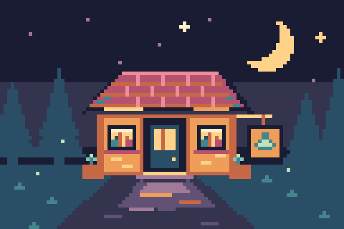
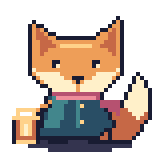
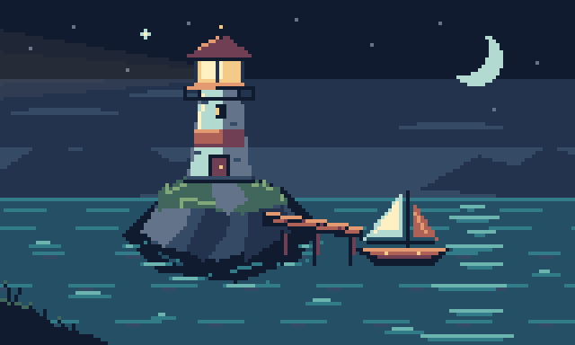

# PixaaC

**Pixel Art as a Code.**

Define pixel art in Python. Compose reusable parts, generate variants, animate
layers, and render assets for your game or app.

The script is the source of truth. A sprite is the result of running it.
Change a palette, adjust a shape, or fix a drawing function, then rebuild every
asset that uses it.



| Lantern fox | Arctic palette | Potion variants |
| --- | --- | --- |
|  |  |  |

[Moonlit Market](assets/moonlit_market/build.py) builds all six assets from Python:
two 40×40 fox variants, three 24×24 potions, and a 96×64 animated shop. The fox
curls its tail, swings its lantern, and blinks; palette variants share geometry
while keeping fur and lantern colors independent.

## Quick start

From a checkout, install with `python -m pip install .`, then run
`python assets/moonlit_market/build.py`. Open `assets/moonlit_market/generated/contact-sheet.png`
to see the asset set, or `assets/moonlit_market/generated/fox.gif` and `shop.gif` to see the
animations. The build also produces native PNGs, APNGs, sprite sheets with JSON,
and editable snapshots.

Try this from the checkout root (save as `draw_fox.py`, then run
`python draw_fox.py`):

```python
from assets.moonlit_market.build import build_fox

fox = build_fox()
fox.export_png("assets/generated/fox.png")
fox.export_gif("assets/generated/fox-idle.gif", tag="idle", scale=6)
fox.export_sheet("assets/generated/fox-sheet.png", columns=4, padding=2, extrude=1)

arctic = fox.copy(name="arctic-fox")
arctic.palette.set("F", "#c9e0dd")  # Fur base; lantern light has its own keys.
arctic.palette.set("O", "#799cac")
arctic.palette.set("H", "#e8eac1")
arctic.export_png("assets/generated/arctic-fox.png", scale=6)
```

Edit `build_fox()` once to update the silhouette of every variant, or change
shared palette keys to recolor every pose. Drawing happens in memory; files are
written only when you explicitly save or export.

## Recent improvements

- **Inspect while drawing:** live reload, native pixel coordinates, a pixel grid,
  pink/cyan onion skins, and independent pose or palette comparison. Comparison
  panes stack on narrow screens, and script errors retain the last good images.
- **Compose without accidental recoloring:** `Layer.blit()` imports missing
  palette keys and requires explicit mappings for color conflicts.
- **Export dependable textures:** optional sheet-edge extrusion, validated
  dimensions, and frame metadata that preserves animation order and timing.
- **Keep deliberate shades:** GIF export preserves exact colors for frames
  with up to 255 visible RGB colors. APNG preserves full RGBA.

The [feedback log](IMPROVEMENTS.md) records the art-driven iterations. The latest
verification includes 140 passing tests, isolated-wheel checks, and a
[connected-browser pass](docs/browser-feedback.md) covering playback, layout,
source edits, and error recovery.

## Install

Python 3.12 or newer. From a checkout:

```bash
python -m pip install .
```

For development:

```bash
uv sync
uv run python assets/moonlit_market/build.py
uv run pytest
```

Pillow is the only runtime dependency. PixaaC runs locally and works in scripts,
notebooks, build jobs, and agent coding environments.

## Watch a live preview

```bash
python -m pixaac.preview assets/moonlit_market/build.py --sprite fox
# With uv: uv run python -m pixaac.preview assets/moonlit_market/build.py --sprite fox
```

Open the printed local URL (normally <http://127.0.0.1:8765>) once. Save changes
to shapes, palettes, or frame durations and the preview refreshes automatically.
Select a sprite or animation tag, play/pause, step frames, or choose a
nearest-neighbor zoom. Transparency appears over a checkerboard; frame names
and durations are displayed below the image. A failed script shows its traceback
while keeping the last successful images. Fix it and save to resume updates.

Hover either image to read native pixel `(x, y)` coordinates, starting at `(0, 0)`
in the top-left corner. The readout follows zoom and scrolling and clears outside
the visible image. **Pixel grid** marks native pixel boundaries at 2× and above;
at 1× it shows only the outer edge so the image stays legible. Zoom and grid
choices survive rebuilds.

**Previous pose** (pink) and **Next pose** (cyan) independently overlay adjacent
poses on the primary image. Adjust **Onion opacity** from 0–100%. Overlays remain
visible during playback and follow the selected tag's forward, reverse, or
pingpong sequence. They wrap for looping tags; one-shot boundaries omit the
missing neighbor and stepping stops at either end. Single-frame selections show
no onion skins. **Pose** selects a position in the playback sequence and pauses.

Enable **Compare** for a second pane with independent sprite and frame selectors.
Both panes share zoom and grid settings and align their canvas origins at the
top left. Below 651 px viewport width, the panes stack vertically to keep the
art and controls usable. The second pane holds its selected pose while the
primary pane plays; each pane labels its asset, frame, and duration. Rebuilds retain available asset
and frame names (including the current pingpong occurrence). A removed frame
falls back to the first available pose; a removed asset falls back to the first
available asset. All overlays are browser-only and never enter exported images.

Select `fox` and compare it with `arctic`: their lanterns match at pixel
`(5, 31)` while their fur differs. Choose `shop` to inspect the animated scene,
or `mint`, `rose`, and `amber` to compare the potion palettes. The
[refinement notes](docs/moonlit-market-refinement.md) explain the palette roles
and provide a coordinate-based inspection walkthrough.

Expose a module-level `preview_assets` value or a zero-argument function:

```python
from assets.moonlit_market.build import build_fox

def preview_assets():
    fox = build_fox()
    arctic = fox.copy(name="arctic-fox")
    for key, color in {"F": "#c9e0dd", "O": "#799cac", "H": "#e8eac1"}.items():
        arctic.palette.set(key, color)
    return {"fox": fox, "arctic": arctic}  # Or return one Sprite directly.
```

The [Moonlit Market script](assets/moonlit_market/build.py) exposes all six assets.
The watcher executes your script in a fresh Python process on each rebuild,
with the script's directory on the import path. Its `if __name__ == "__main__":`
block is skipped, so put batch exports there and expose preview assets outside
that block. Top-level code still runs; keep expensive or unrelated side effects
inside the main block too. Preview is for your own authoring scripts.

Python files under the working directory are watched when the script lives
there; otherwise its containing directory is watched. This includes local art
modules, new files, and deletions. `generated/` directories, virtual environments, build
folders, and hidden directories are skipped. Add other source locations with
repeatable `--watch ../shared-art` options. Non-Python inputs can be watched by
passing their individual file paths. `--sprite arctic` selects an initial asset;
asset names are URL-encoded automatically. If the requested name is missing,
the preview shows the first available asset and a message explaining the
fallback. `--port 9000` changes the port. Builds time out after 30 seconds.

Preview is optional, binds only to localhost, and uses Python's standard library
plus the existing Pillow dependency. Ordinary SDK imports start no server or
watcher. Stop it with Ctrl-C; the Python script remains the source of truth.

For development, `uv run pytest` includes HTTP, watcher, export, and preview
controller regression checks. The client checks use Node.js 22+ when installed
(otherwise pytest reports a skip); run them directly with
`node --test tests/preview.test.mjs`. They use a small DOM adapter, so a browser
pass is still needed to verify rendering and interaction.

## The programming model

| Object | Purpose |
| --- | --- |
| `Sprite` | Canvas dimensions, palette, frames, and animation tags |
| `Frame` | A named pose with a duration in milliseconds |
| `Layer` | A drawing surface within a frame |
| `Palette` | Single-character keys mapped to RGB or RGBA colors |
| Python function | A reusable part, drawing rule, or complete asset |

A sprite starts with one frame, `frame0`, and a transparent `base` layer.
`sprite.layer("head")` gets or creates a named layer in frame zero. New layers
are added above existing layers and added to every frame. Drawing into a layer
changes only that frame. `sprite.frame("blink").layer("head")` addresses another
pose explicitly.

There is no global canvas or implicit current frame. Functions receive the
surface they draw on, so independent sprites can be built in the same process.

## Manage the layer stack

`fox.layer_names()` lists names from bottom to top. `frame.layers` returns
live layer handles in that same order. `layer(name)` gets or creates a layer;
`get_layer(name)` on a sprite or frame is strict and raises `SpriteError` with
available names when a layer is missing.

```python
stack = fox.copy(name="fox-layer-study")
print(stack.layer_names())
lantern = stack.get_layer("lantern")
stack.move_layer("lantern", to=stack.layer_names().index("arm"))
stack.rename_layer("lantern", "hand-lantern")
assert lantern.name == "hand-lantern"
# The lantern now sits behind the arm in every frame.
```

Moving, renaming, and removing layers affect **every frame**, including blank
frames; drawings and visibility edits affect only the addressed frame.
`move_layer(name, to)` uses a zero-based final position (zero is bottom), clamped
to the stack bounds. `rename_layer(name, new_name)` rejects duplicate and empty
names. Existing handles follow renames, reorders, and canvas resizes.
`remove_layer(name)` removes its pixels from every frame and requires at least
one layer to remain. All uses of a removed handle raise `SpriteError`, even if a
new layer later reuses its name. Copies of a sprite remain independent.

## Draw shapes and place pixels

Use geometry for silhouettes and palette-key grids for small, deliberate details.
Both write to the same pixel surface.

```python
study = fox.copy(name="fox-detail-study")
details = study.layer("sparkles")
details.polygon([(31, 5), (33, 3), (35, 5), (33, 7)], "y")
details.line((33, 8), (33, 10), "w")
details.stamp(
    "kkk\n"
    "kwk\n"
    "kkk",
    x=3, y=17,
)
```

| Operation | Example |
| --- | --- |
| One pixel | `layer.pixel(4, 7, "c")` |
| Several pixels | `layer.pixels([(4, 7), (9, 7)], "c")` |
| Line | `layer.line((2, 3), (8, 3), "y")` |
| Rectangle | `layer.rect((2, 3, 8, 7), "o")` |
| Ellipse | `layer.ellipse((2, 3, 8, 7), "o", fill=False)` |
| Polygon | `layer.polygon([(2, 7), (5, 2), (8, 7)], "o")` |
| Flood fill | `layer.fill(5, 5, "o")` |
| Stamp | `layer.stamp("kk\nko", x=4, y=6)` |
| Copy a layer | `layer.blit(source_layer, x=4, y=6)` |
| Replace a layer | `layer.set_grid("..kk..\n.kook.\n..kk..")` |
| Outline | `layer.outline("k", outer_only=True)` |
| Recolor pixels | `layer.replace({"o": "v", "y": "w"})` |
| Erase a region | `layer.clear(region=(2, 3, 8, 7))` |

Drawing and transform methods mutate the selected layer and return an
affected-pixel count. Primitive writes count pixels written, including repeated
writes of the same key. Methods do not print or save automatically.

### Pixel rules

- Coordinates are integers, with `(0, 0)` at the top left. X increases rightward;
  Y increases downward. Box corners and line endpoints are inclusive.
- Rectangles, ellipses, and polygons are filled by default. Use `fill=False`
  for a one-pixel perimeter.
- Every palette key is one non-whitespace character. `.` is always transparent.
  Colors accept `#RGB`, `#RGBA`, `#RRGGBB`, and `#RRGGBBAA`.
- Drawing is at native resolution, with no antialiasing. Integer export scales
  use nearest-neighbor sampling. A 32×32 sprite stays 32×32 unless resized.
- Shapes and stamps are clipped at the canvas edge. Individual `pixel` calls
  and flood-fill seeds must be inside it. Leave room around silhouettes when
  adding an outline.
- Stamp rows are separated by newlines; spaces inside rows are ignored.
  Short rows are padded with transparency. Leading blank lines consume rows.
  `.` skips existing pixels unless `overwrite=True`.
- `set_grid` replaces the entire layer and rejects a grid larger than the canvas.
  Unknown palette keys raise `SpriteError`.
- Outlining with the same key is safe to repeat: it completes the contour
  without growing another ring.

## Reuse parts with Python functions

A component is an ordinary function. Give it a layer, an origin, and parameters.
Use loops for repeated details and conditionals for visual variants.

```python
from pixaac import Layer

def sparkle(layer: Layer, x: int, y: int, key: str = "y"):
    layer.stamp(f".{key}.\n{key}{key}{key}\n.{key}.", x=x - 1, y=y - 1)

for x, y in ((34, 12), (4, 8)):
    sparkle(details, x, y)
```

Keep the head, body, tail, lantern, and effects on separate layers when they need to
move independently. Put shared palettes and drawing functions in regular Python
modules. Rebuilding an asset set is a loop over those functions.

The [Moonlit Market example](assets/moonlit_market/build.py) uses reusable stars,
trees, tail poses, and arm poses alongside its fox, potion, and shop factories.

## Generate variants

Changing a palette entry changes every pixel using that key across all frames.
Copies have independent palettes, pixels, and animation metadata.

```python
arctic = fox.copy(name="arctic-fox")
for key, color in {
    "F": "#c9e0dd", "O": "#799cac", "H": "#e8eac1",
    "r": "#655986", "p": "#a397bb",
}.items():
    arctic.palette.set(key, color)
arctic.export_gif("assets/generated/arctic-idle.gif", tag="idle", scale=6)
```

Use `layer.replace(...)` to change which keys selected pixels use. Use
`sprite.palette.set(...)` to change what those keys look like.

Use separate keys for materials that should recolor independently. The fox's
fur uses `F/O/H/C`; its lantern uses `L/E/G/I`. A fur highlight and lantern glow
can start with the same RGB value without becoming coupled during recoloring.

Built-in palettes are available as dictionaries:

```python
from pixaac import Sprite, presets

icon = Sprite(16, 16, palette=presets.get("sweetie-16").as_dict())
```

Presets include `pico-8`, `sweetie-16`, `endesga-32`, `gameboy`, and `1bit`.

### Compose assets with different palettes

`Layer.blit()` copies another layer's pixels at an integer offset and clips at
the destination canvas. Missing palette keys are imported; existing keys must
have matching RGBA colors. A conflict raises `SpriteError` before changing pixels
or the palette. Explicit mappings resolve conflicting keys:

```python
from assets.moonlit_market.build import PALETTE, preview_assets
from pixaac import Sprite

assets = preview_assets()
pair = Sprite(88, 44, palette=PALETTE, name="fox-pair")
for name, x, mapping in (
    ("fox", 2, {}),
    ("arctic", 46, {"F": "A", "O": "B", "H": "D", "r": "R", "p": "P"}),
):
    for part in assets[name].frame().layers:
        pair.layer(f"{name}/{part.name}").blit(part, x=x, y=2, mapping=mapping)
pair.export_png("assets/generated/fox-pair.png", scale=4)
```

New mapped keys receive the source color. Mapping to an existing key deliberately
uses the destination color, allowing explicit recoloring. Distinct material keys
remain distinct even when their colors match. Only keys inside the clipped
placement are imported. Transparency skips existing pixels unless
`overwrite=True`; that option clears them. Copying snapshots the source pixels,
so overlapping self-copy is safe. Source visibility and opacity are not copied.
Each call is atomic; a loop over several layers is a series of separate edits.

## Animate named frames

The fox factory already supplies `frame0`, `breathe-in`, `blink`, and `exhale`,
with `idle`, `breathing`, and `reverse-reaction` tags. Extend it by duplicating a
pose, changing the relevant layers, and naming a playback range. New frames are
blank unless `copy_from` is supplied.

```python
motion = build_fox()
look_up = motion.add_frame("look-up", copy_from=0, duration_ms=180)
look_up.shift_layers(["head", "face"], 0, -1)

motion.tag("reaction", 0, len(motion.frames) - 1, direction="pingpong")
motion.export_apng("assets/generated/fox-reaction.png", tag="reaction", scale=6)
motion.export_sheet("assets/generated/fox-reaction-sheet.png", columns=5, padding=2, extrude=1)
```

Tags use inclusive frame indices and support `forward`, `reverse`, and
`pingpong` playback. Durations are positive integer milliseconds.
`loop=False` marks a tag for one-shot playback.

Transforms operate on a layer in one frame:

```python
pose = fox.copy(name="fox-squash")
pose.layer("body").stretch(region=(10, 22, 27, 33), dy=-1, anchor="bottom")
pose.export_png("assets/generated/fox-squash.png")
```

`shift` supports selected keys, a region, wrapping, and transparent overwrite.
Pixels shifted past the canvas edge are discarded unless `wrap=True`.
`flip` supports horizontal or vertical axes, `rotate` makes quarter turns on a
square canvas, and `mirror` copies one half to the other. `stretch` uses
nearest-neighbor sampling and preserves the region's border pixels.

### Move related parts together

Select named layers in one frame with `frame.shift_layers(names, dx, dy)`:

```python
movement = build_fox()
pose = movement.add_frame("higher", copy_from=0, duration_ms=180)
pose.shift_layers(["body", "head", "face", "scarf"], 0, -1)
assert pose.get_layer("feet").rows() == movement.get_layer("feet").rows()
# Each part is still an ordinary, independently editable layer.
pose.get_layer("scarf").pixel(15, 23, "p")
```

The [fox's breathing pose](assets/moonlit_market/build.py) moves these four layers
together, then redraws the tail and arm and shifts the lantern independently.
Its feet and shadow remain planted.

For reusable parts, use a shared **character origin**: `(x, y)` is the top-left
of the character's bounding box, and every part adds its own local offsets.
Pass the same origin to each drawing function. This gives the accessory and
character a common coordinate system without storing extra transform state.

`shift_layers` resolves all names strictly before changing pixels. Duplicate
names are moved once, an empty selection does nothing, and the return value
sums the individual affected-pixel counts. It affects only the selected frame.
Pixels leaving the canvas are discarded; `wrap=True` wraps each layer around
the entire canvas. Layers keep their names, stacking order, and editability.
Ordinary drawing functions and explicit layer selections keep these parts
reusable without requiring a separate component hierarchy.

## Render and export

| Output | Method | Use |
| --- | --- | --- |
| Pillow RGBA image | `sprite.render()` | Notebook display, image processing, custom pipelines |
| Transparent PNG | `sprite.export_png(path)` | A single frame at native size |
| Enlarged PNG | `sprite.export_png(path, scale=8)` | Pixel-sharp review preview |
| Individual frames | `sprite.export_frames(directory)` | One PNG per frame |
| Sprite sheet + JSON | `sprite.export_sheet(path, columns=4)` | Aseprite-compatible array metadata |
| Animated PNG | `sprite.export_apng(path, tag="idle")` | Animation with full RGBA colors |
| Animated GIF | `sprite.export_gif(path, tag="idle")` | Widely supported animation preview |
| Editable snapshot | `sprite.save(path)` | Palette, layers, frames, and tags as JSON |

Exports create parent directories and replace existing outputs. PNGs and APNGs
preserve transparency. Supply `background="#243342"` to flatten a preview onto
a solid color. GIF has palette and transparency limits; use APNG for full RGBA.
Sheets contain the source frames once, with playback directions in their tag
metadata.

GIF export preserves exact visible RGB colors when a frame uses at most 255
colors, reserving one index for transparency. Larger palettes are quantized.
GIF treats alpha below 128 as transparent and the rest as opaque, and its timing
uses 10 ms units. Use APNG when partial transparency or finer timing matters.

For game textures, `sprite.export_sheet(path, columns=4, padding=2, extrude=1)`
duplicates each frame's outer texels into a border. JSON frame rectangles exclude
that border, so importers still select the original content. `extrude` and
`padding` are measured in **output pixels**, independent of `scale`; padding
remains transparent between bordered cells and around the sheet. Both default
to zero. Use nonnegative integers for them, and positive integers for `scale`
and `columns` (or `columns=None` for one row). Invalid geometry fails before
writing either output.

Extrusion helps prevent neighboring texels from bleeding into a frame under
texture filtering. It duplicates transparent edges too; it does not remove
transparent margins, generate mipmaps, or configure your engine's sampler.

```python
from pixaac import Sprite

image = fox.render(frame="breathe-in", scale=6, background="#243342")
assert image.size == (240, 240)

fox.save("assets/generated/fox.sprite.json")
restored = Sprite.load("assets/generated/fox.sprite.json")
```

`Sprite.from_png("assets/generated/fox-sheet.png")` restores frame rectangles, names,
durations, tags, and palette when the adjacent sheet JSON is present. A flattened
image cannot recover separate drawing layers. Without metadata, supply
`frame_width` and `frame_height` to slice a sheet, or import a single PNG.

## Troubleshooting

- **An accessory covers the character:** layers composite from bottom to top;
  layers created later start above earlier ones. Inspect and adjust the stack
  when overlapping parts look wrong.
- **An outline is cut off:** outlines are clipped at the canvas boundary. Leave
  a pixel of transparent margin or enlarge the canvas before outlining.
- **A new pose is blank:** `add_frame()` creates transparent layers. Supply
  `copy_from=0` (or a named frame) to start from an existing drawing.

## Inspect and verify

The [Tideglass Station example](assets/tideglass/build.py) exercises scene
composition and a complete animated asset delivery:

```bash
uv run python assets/tideglass/build.py
uv run python -m pixaac.preview assets/tideglass/build.py --sprite station
```

`assets/tideglass/generated/` contains native PNGs, enlarged previews, GIF/APNG animations,
extruded sheets with JSON, editable snapshots, and `review.png` / `poses.png`
inspection boards. The [feedback log](docs/tideglass-feedback.md) records the
art and SDK changes discovered while making these assets, along with validation
and outstanding release gates.



The [release procedure](docs/releasing.md) includes isolated-wheel verification
and repeatable browser checks. Integration checks for a particular game engine
are optional until you choose a project that will consume the assets.

Inspect the pixels directly or work with the rendered image:

```python
print(fox.inspect(frame=0, layer="head"))
print(fox.get_layer("head").bounds())
assert fox.validate() == []
assert fox.render().getpixel((0, 0))[3] == 0
```

`layer.rows()` returns palette-key strings; `layer.histogram()` counts their
usage. `sprite.validate()` returns structural problems, or an empty list for a
consistent document.

For procedural art, own randomness explicitly with a seeded Python
`random.Random`. Identical drawing inputs produce identical pixels. Pin your
Python and dependency versions when reproducible encoded files also matter.

To regenerate the documented Moonlit Market and Tideglass artwork:

```bash
python -m assets.build_showcase
```

This runs the collection builders, refreshes their ignored `generated/` exports,
and updates the curated images in each collection's `showcase/` folder.
Browser screenshots are kept separately under `assets/screenshots/`.

## Project layout

All artwork lives under [`assets/`](assets/README.md), grouped by collection:

```text
assets/
  moonlit_market/
    build.py        # source palettes, parts, and asset factories
    showcase/       # curated images used by README and feedback notes
    generated/      # rebuildable exports; ignored by Git
  tideglass/        # same structure for the coastal asset set
  robot/            # additional SDK example, exercised by tests
  courier/          # grouped-movement example, exercised by tests
  fixtures/         # legacy snapshot used by compatibility tests
  screenshots/      # browser verification evidence
  generated/        # scratch outputs from README code snippets; ignored
  build_showcase.py # regenerate the documented artwork
```

An asset build is a Python program. It can accept arguments, read configuration,
run under a build system, and return a failing exit code if validation fails.
Generated PNGs and sprite snapshots are outputs; editing the Python source and
running it again is the primary workflow. Builders default to their own
collection's `generated/` directory regardless of the current working directory;
pass an output directory argument to export elsewhere.

## Design principles

1. **Python is the authoring language.** Functions, loops, modules, and data
   structures express the artwork.
2. **Pixel decisions stay explicit.** Palette keys, integer coordinates,
   native-resolution drawing, and predictable clipping define the result.
3. **Composition scales the work.** Reusable parts and independent layers make
   families of assets practical.
4. **Iteration stays local.** Build in memory, render on demand, and inspect
   both the image and the pixels.
5. **Outputs belong in real projects.** Standard images and sprite-sheet
   metadata connect the art to games, apps, documentation, and build pipelines.
