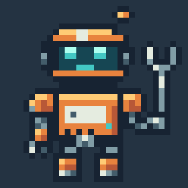
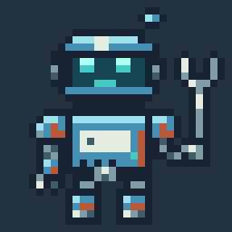
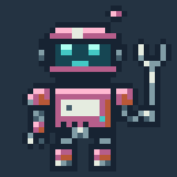

# PixaaS

**Pixel Art as a Code.**

Define pixel art in Python. Compose reusable parts, generate variants, animate
layers, and render assets for your game or app.

The script is the source of truth. A sprite is the result of running it.
Change a palette, adjust a shape, or fix a drawing function, then rebuild every
asset that uses it.

| Sprite | Idle animation | Ice palette | Rose palette |
| --- | --- | --- | --- |
|  |  |  |  |

From a checkout, install with `python -m pip install .`, then run
`python examples/robot.py`. Open `out/bolt-preview.png` or `out/bolt-idle.gif`
to see your first output. The images above come from that checked-in script;
regenerate the documentation images with `python examples/robot.py docs/images`.

Try this from the checkout root (save as `draw_robot.py`, then run
`python draw_robot.py`):

```python
from examples.robot import build_robot

robot = build_robot()
robot.export_png("out/bolt.png")
robot.export_png("out/bolt-preview.png", scale=8)

ice = robot.copy(name="bolt-ice")
ice.palette.set("o", "#468fb5")
ice.palette.set("y", "#9de1ed")
ice.export_png("out/bolt-ice.png", scale=8)
head = robot.layer("head")
```

Edit `build_robot()` once to update the silhouette of every variant, or change
shared palette keys to recolor every pose. Drawing happens in memory; files are
written only when you explicitly save or export.

## Install

Python 3.12 or newer. From a checkout:

```bash
python -m pip install .
```

For development:

```bash
uv sync
uv run python examples/robot.py
uv run pytest
```

Pillow is the only runtime dependency. PixaaS runs locally and works in scripts,
notebooks, build jobs, and agent coding environments.

## The programming model

| Object | Purpose |
| --- | --- |
| `Sprite` | Canvas dimensions, palette, frames, and animation tags |
| `Frame` | A named pose with a duration in milliseconds |
| `Layer` | A drawing surface within a frame |
| `Palette` | Single-character keys mapped to RGB or RGBA colors |
| Python function | A reusable part, drawing rule, or complete asset |

A sprite starts with one frame, `frame0`, and a transparent `base` layer.
`sprite.layer("head")` gets or creates a named layer in frame zero. New layers
are added above existing layers and added to every frame. Drawing into a layer
changes only that frame. `sprite.frame("blink").layer("head")` addresses another
pose explicitly.

There is no global canvas or implicit current frame. Functions receive the
surface they draw on, so independent sprites can be built in the same process.

## Draw shapes and place pixels

Use geometry for silhouettes and palette-key grids for small, deliberate details.
Both write to the same pixel surface.

```python
details = robot.layer("details")
details.polygon([(25, 15), (27, 13), (29, 15), (27, 17)], "s")
details.line((27, 17), (27, 24), "w")
details.stamp(
    "kkk\n"
    "kwk\n"
    "kkk",
    x=14, y=21,
)
```

| Operation | Example |
| --- | --- |
| One pixel | `layer.pixel(4, 7, "c")` |
| Several pixels | `layer.pixels([(4, 7), (9, 7)], "c")` |
| Line | `layer.line((2, 3), (8, 3), "y")` |
| Rectangle | `layer.rect((2, 3, 8, 7), "o")` |
| Ellipse | `layer.ellipse((2, 3, 8, 7), "o", fill=False)` |
| Polygon | `layer.polygon([(2, 7), (5, 2), (8, 7)], "o")` |
| Flood fill | `layer.fill(5, 5, "o")` |
| Stamp | `layer.stamp("kk\nko", x=4, y=6)` |
| Replace a layer | `layer.set_grid("..kk..\n.kook.\n..kk..")` |
| Outline | `layer.outline("k", outer_only=True)` |
| Recolor pixels | `layer.replace({"o": "s", "y": "w"})` |
| Erase a region | `layer.clear(region=(2, 3, 8, 7))` |

Drawing and transform methods mutate the selected layer and return an
affected-pixel count. Primitive writes count pixels written, including repeated
writes of the same key. Methods do not print or save automatically.

### Pixel rules

- Coordinates are integers, with `(0, 0)` at the top left. X increases rightward;
  Y increases downward. Box corners and line endpoints are inclusive.
- Rectangles, ellipses, and polygons are filled by default. Use `fill=False`
  for a one-pixel perimeter.
- Every palette key is one non-whitespace character. `.` is always transparent.
  Colors accept `#RGB`, `#RGBA`, `#RRGGBB`, and `#RRGGBBAA`.
- Drawing is at native resolution, with no antialiasing. Integer export scales
  use nearest-neighbor sampling. A 32×32 sprite stays 32×32 unless resized.
- Shapes and stamps are clipped at the canvas edge. Individual `pixel` calls
  and flood-fill seeds must be inside it. Leave room around silhouettes when
  adding an outline.
- Stamp rows are separated by newlines; spaces inside rows are ignored.
  Short rows are padded with transparency. Leading blank lines consume rows.
  `.` skips existing pixels unless `overwrite=True`.
- `set_grid` replaces the entire layer and rejects a grid larger than the canvas.
  Unknown palette keys raise `SpriteError`.
- Outlining with the same key is safe to repeat: it completes the contour
  without growing another ring.

## Reuse parts with Python functions

A component is an ordinary function. Give it a layer, an origin, and parameters.
Use loops for repeated details and conditionals for visual variants.

```python
from pixaas import Layer

def rivet(layer: Layer, x: int, y: int):
    layer.stamp("kk\nkw", x=x, y=y)

def vent(layer: Layer, x: int, y: int, slots: int = 3):
    for offset in range(slots):
        layer.line((x + offset * 2, y), (x + offset * 2, y + 1), "k")

for x in (11, 19):
    rivet(details, x, 17)
vent(details, 13, 22)
```

Keep the head, body, held tool, and effects on separate layers when they need to
move independently. Put shared palettes and drawing functions in regular Python
modules. Rebuilding an asset set is a loop over those functions.

The [mechanic robot example](examples/robot.py) demonstrates a complete asset
factory with a reusable palette, separate parts, and an idle animation.

## Generate variants

Changing a palette entry changes every pixel using that key across all frames.
Copies have independent palettes, pixels, and animation metadata.

```python
ice_robot = robot.copy(name="bolt-ice")
ice_robot.palette.set("o", "#468fb5")
ice_robot.palette.set("y", "#9de1ed")
ice_robot.export_png("out/bolt-ice.png")
```

Use `layer.replace(...)` to change which keys selected pixels use. Use
`sprite.palette.set(...)` to change what those keys look like.

Built-in palettes are available as dictionaries:

```python
from pixaas import Sprite, presets

icon = Sprite(16, 16, palette=presets.get("sweetie-16").as_dict())
```

Presets include `pico-8`, `sweetie-16`, `endesga-32`, `gameboy`, and `1bit`.

## Animate named frames

Duplicate a pose, change the relevant layers, then name the playback range.
New frames are blank unless `copy_from` is supplied.

```python
robot.frame(0).duration_ms = 180

up = robot.add_frame("up", copy_from=0, duration_ms=120)
up.layer("head").shift(0, -1)

blink = robot.add_frame("blink", copy_from=0, duration_ms=100)
face = blink.layer("head")
face.replace({"c": "t"})
for x in (12, 18):
    face.line((x, 9), (x + 1, 9), "c")

robot.tag("idle", 0, 2, direction="pingpong")
robot.export_apng("out/bolt-idle.png", tag="idle", scale=8)
robot.export_sheet("out/bolt-sheet.png", columns=3, padding=1)
```

Tags use inclusive frame indices and support `forward`, `reverse`, and
`pingpong` playback. Durations are positive integer milliseconds.
`loop=False` marks a tag for one-shot playback.

Transforms operate on a layer in one frame:

```python
pose = robot.copy(name="bolt-squash")
pose.layer("body").stretch(region=(8, 15, 23, 30), dy=-2, anchor="bottom")
pose.export_png("out/bolt-squash.png")
```

`shift` supports selected keys, a region, wrapping, and transparent overwrite.
Pixels shifted past the canvas edge are discarded unless `wrap=True`.
`flip` supports horizontal or vertical axes, `rotate` makes quarter turns on a
square canvas, and `mirror` copies one half to the other. `stretch` uses
nearest-neighbor sampling and preserves the region's border pixels.

## Render and export

| Output | Method | Use |
| --- | --- | --- |
| Pillow RGBA image | `sprite.render()` | Notebook display, image processing, custom pipelines |
| Transparent PNG | `sprite.export_png(path)` | A single frame at native size |
| Enlarged PNG | `sprite.export_png(path, scale=8)` | Pixel-sharp review preview |
| Individual frames | `sprite.export_frames(directory)` | One PNG per frame |
| Sprite sheet + JSON | `sprite.export_sheet(path, columns=4)` | Aseprite-compatible array metadata |
| Animated PNG | `sprite.export_apng(path, tag="idle")` | Animation with full RGBA colors |
| Animated GIF | `sprite.export_gif(path, tag="idle")` | Widely supported animation preview |
| Editable snapshot | `sprite.save(path)` | Palette, layers, frames, and tags as JSON |

Exports create parent directories and replace existing outputs. PNGs and APNGs
preserve transparency. Supply `background="#243342"` to flatten a preview onto
a solid color. GIF has palette and transparency limits; use APNG for full RGBA.
Sheets contain the source frames once, with playback directions in their tag
metadata.

```python
image = robot.render(frame="up", scale=8, background="#243342")
assert image.size == (256, 256)

robot.save("out/bolt.sprite.json")
restored = Sprite.load("out/bolt.sprite.json")
```

`Sprite.from_png("out/bolt-sheet.png")` restores frame rectangles, names,
durations, tags, and palette when the adjacent sheet JSON is present. A flattened
image cannot recover separate drawing layers. Without metadata, supply
`frame_width` and `frame_height` to slice a sheet, or import a single PNG.

## Troubleshooting

- **An accessory covers the character:** layers composite from bottom to top;
  layers created later start above earlier ones. Inspect and adjust the stack
  when overlapping parts look wrong.
- **An outline is cut off:** outlines are clipped at the canvas boundary. Leave
  a pixel of transparent margin or enlarge the canvas before outlining.
- **A new pose is blank:** `add_frame()` creates transparent layers. Supply
  `copy_from=0` (or a named frame) to start from an existing drawing.

## Inspect and verify

Inspect the pixels directly or work with the rendered image:

```python
print(robot.inspect(frame=0, layer="head"))
print(head.bounds())
assert robot.validate() == []
assert robot.render().getpixel((0, 0))[3] == 0
```

`layer.rows()` returns palette-key strings; `layer.histogram()` counts their
usage. `sprite.validate()` returns structural problems, or an empty list for a
consistent document.

For procedural art, own randomness explicitly with a seeded Python
`random.Random`. Identical drawing inputs produce identical pixels. Pin your
Python and dependency versions when reproducible encoded files also matter.

## Project layout

Keep source art next to the code that uses it:

```text
art/
  palettes.py       # shared colors
  parts.py          # eyes, joints, armor, foliage
  characters.py     # asset factories
  build.py          # variants, animations, exports
out/
  characters.png
  characters.json
```

An asset build is a Python program. It can accept arguments, read configuration,
run under a build system, and return a failing exit code if validation fails.
Generated PNGs and sprite snapshots are outputs; editing the Python source and
running it again is the primary workflow.

## Design principles

1. **Python is the authoring language.** Functions, loops, modules, and data
   structures express the artwork.
2. **Pixel decisions stay explicit.** Palette keys, integer coordinates,
   native-resolution drawing, and predictable clipping define the result.
3. **Composition scales the work.** Reusable parts and independent layers make
   families of assets practical.
4. **Iteration stays local.** Build in memory, render on demand, and inspect
   both the image and the pixels.
5. **Outputs belong in real projects.** Standard images and sprite-sheet
   metadata connect the art to games, apps, documentation, and build pipelines.
