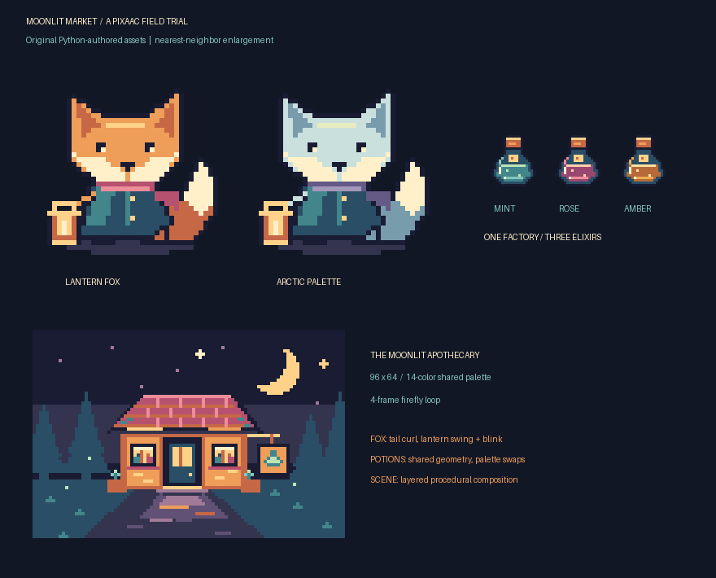
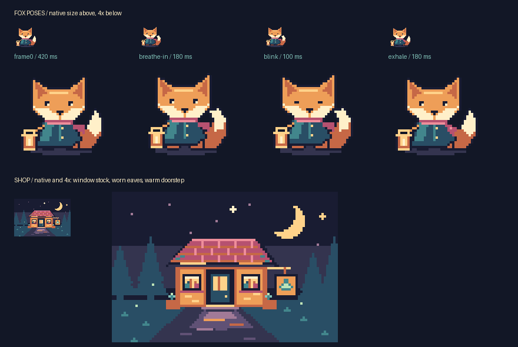

# Moonlit Market refinement

The [authoring script](../assets/moonlit_market/build.py) still produces six assets:
two fox palettes, three potions, and the animated shop. Run:

```sh
python assets/moonlit_market/build.py
python -m pixaac.preview assets/moonlit_market/build.py --sprite fox
```

The build regenerates native and enlarged PNGs, sheets, editable snapshots,
GIF/APNG animations, a contact sheet, and `pose-review.png` under
`assets/moonlit_market/generated/`. The preview command prints a working, URL-encoded asset
selection link.



## Palette roles

The fox uses `F/O/H/C` for fur base, shadow, highlight, and cream.
The lantern uses `L/E/G/I` for brass, ember, glow, and core. Keys express
independently editable material roles, even when their RGB values match:
`H`, `L`, and `G` initially all equal `#ffd28a`. Changing fur key `H` no longer
changes the lantern's `G` or `L`. The arctic variant changes `F/O/H` and scarf
keys `r/p`; potions keep their existing palette swaps.

A concrete before/after is the arctic fox's lantern at **(5, 31)** in `frame0`:
it previously used shared key `y`, so the arctic recolor turned it `#e8eac1`.
It now uses lantern glow `G` and stays **#ffd28a** in both variants. The core at
**(6, 31)** stays **#fff0c9**. All four poses preserve lantern colors across
variants; a regression test checks the rendered accessory pixels.

To inspect this change in the new UI, select `fox`, enable **Compare**, and
select `arctic` / `frame0` in the second pane. Pause the primary pane at
`frame0`, turn on **Pixel grid**, and hover **(5, 31)** at 8× and 16×.
The two lanterns should match while the fur differs. A fox eye begins at
**(13, 15)**; this is another useful point for checking source edits against
the coordinate readout. These steps were completed in the
[2026-09-14 browser-use verification](browser-feedback.md), including an edit
to the eye pixel in a temporary source fixture and its visible refresh.

## Pose and scene changes

Inhalation now curls the tail inward, bends the arm, and swings the lantern
one pixel right and up while the body and head rise. The tail tip near
**(30, 19)** changes shape rather than translating the original silhouette.
The exhale pose settles the scarf after the body. Feet and shadow stay fixed,
and tail, arm, face, scarf, and lantern remain independently editable layers.

In the preview, choose `idle` and enable both onion skins at 25% opacity.
Step through `frame0`, `breathe-in`, `blink`, and `exhale`. Pink marks the
previous pose and cyan the next; the tail and lantern should move while the
feet remain aligned. The skins remain enabled during playback. Use
`reverse-reaction` to inspect one-shot boundaries and `breathing` to inspect
pingpong order.

The shop adds warm pools and broken reflections leading to the doorway,
small bottles on the window shelves, timber seams, worn roof edges, and a
bright doorstep. These details have separate layers where useful.



The regenerated static review was inspected at native resolution and 4×:
the curled tail changes the outline, the feet stay planted, and the window
stock and doorway lighting read at 96×64. The changes are a focused refinement
of the original geometric scene.

## Verification and remaining friction

Durable tests cover the exact CLI-printed HTTP URLs (including spaces, Unicode,
and reserved characters), unknown-path 404s, coordinate math at every zoom and
scrolled origin, tag neighbors, playback and stepping, two-pane selections,
rebuild retention, visible error state, and recovery. The client tests execute
the real controller through a small DOM adapter; they do not verify browser
layout, CSS filters, checkerboard appearance, or pointer hit testing.

All six assets reproduce identically and round-trip through sheets and
snapshots with their rendered pixels, frame names, and durations intact.
Snapshots also retain layer order. Existing tagged GIF/APNG regression coverage
and imported-module watcher tests remain in place.

The initial browser runtime reported no available browsers. The subsequent
browser-use pass verified the printed URL, play/pause and stepping,
nearest-neighbor zoom, transparency, grid and onion alignment, coordinates at
all four corners after scrolling and switching asset sizes, imported-module
edits, syntax errors, and recovery with both panes open. Missing-name fallback,
reverse/pingpong/one-shot and single-frame neighbors, and removal of selected
assets or frames also passed. See the [browser feedback](browser-feedback.md)
for evidence and the narrow-screen layout fix discovered during that pass.

The Python-to-coordinate editing loop still requires editing source and saving.
The UI supplies inspection and comparison, with no painting tools or component
hierarchy.
