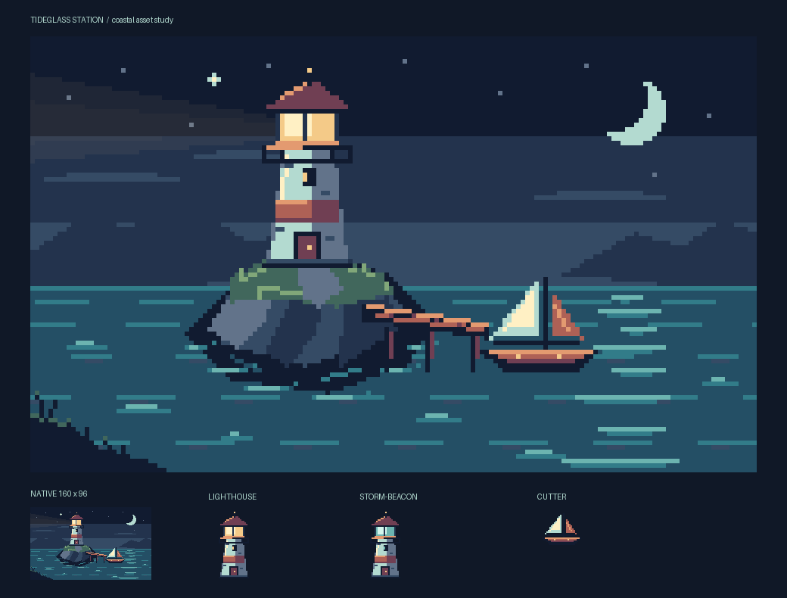

# Tideglass production trial

Date: 2026-09-14. Source: [assets/tideglass/build.py](../assets/tideglass/build.py).
All artwork is made with PixaaC; Pillow only arranges the review board.

## Loop 1 — compose an actual asset set

Built a 160×96 coastal scene, a 32×48 animated lighthouse, a separately
recolored storm beacon, and a 32×24 animated cutter. Exported PNGs, GIFs,
APNGs, sheets, and editable snapshots. Inspected the native scene and 6×
review board in `assets/tideglass/generated/review.png`.

The scene reads at native resolution: the warm lighthouse is the focal point,
the pale sail is the secondary shape, and the cool moon path balances them.
The first pass still has evenly spaced wave marks, flat illumination, and an
empty foreground. Refine these through deliberate clusters and lighting, not
random noise or antialiasing.

**Confirmed composition defect in the workaround:** `place()` joins each
source layer's rows and stamps them into the destination. This preserves keys,
but assumes identical palettes. Composing the storm beacon changed pixel
`(12, 12)` from `(211, 246, 237, 255)` to `(255, 240, 196, 255)`.
This is a limitation of using text stamping for cross-palette composition,
not a defect in the documented `stamp()` semantics.

Implement `Layer.blit(source, x=..., y=..., mapping=...)`: copy palette-key
pixels directly, import missing keys, reject conflicting colors unless explicitly
mapped, and validate before modifying either pixels or the destination palette.
Keep separate source material keys even when their RGB values happen to match.
Support clipped placement, transparent overwrite, and safe self-copy.

## Loop 2 — deliver textures to a game

The initial sheets have transparent padding, but no duplicated border texels.
Game texture sampling can pull gutter colors into frame edges. Add opt-in
edge extrusion, with frame rectangles pointing only at actual content and
padding remaining transparent outside the extruded borders. Inspect a tiny
opaque color fixture as well as the artwork, whose canvas edges are mostly
transparent. Extrusion cannot fill transparent margins inside a sprite.

The trial also found `padding=-1` and `columns=1.5` silently accepted by sheet
export. Validate dimensions before allocating or writing files; use actionable
`SpriteError` messages and preserve existing exports on invalid arguments.

## Release evidence

Starting baseline: 108 tests passed. Final suite: **140 tests passed** on
Python 3.12.9 and Node 22.14.0, including existing preview controller checks.
Source and wheel distributions built successfully. The isolated wheel passed
authoring, composition, extrusion/reimport, animation export, preview worker,
query-string URL routing, and packaged HTML/JavaScript checks.

Every pose of all four assets reproduces exactly from source. Sheets at 2×
with extrusion, editable snapshots, decoded native GIFs, and decoded APNGs
preserve the tested pixels and frame durations. The remapped storm beacon
matches its original render exactly while the destination's warm light keys
remain unchanged. The regression suite also tests partial alpha, transparent
gutters, clipped placements, self-copy, invalid arguments, and nonzero tag ranges.

Inspected the [review board](../assets/tideglass/showcase/review.png) at native and enlarged
sizes, the [complete pose board](../assets/tideglass/showcase/poses.png), and an opaque
2×2 extrusion fixture. That temporary fixture was removed during asset cleanup;
its assertions remain in `tests/test_sheet_extrusion.py`. The fixture confirmed
edge/corner duplication with a transparent gap between frames. The final art has
a quiet beacon beam, broken shoreline highlights, irregular wave lengths, and a
dark foreground that frames the scene. Lamp movement stays inside its glass;
the cutter bobs without losing pixels; the tower and pier remain anchored.

The boards establish spatial readability and pose consistency. Initial browser
discovery returned no available browsers; the subsequent
[browser-use pass](browser-feedback.md) verified preview controls, playback,
rendering, and source-error recovery, and fixed narrow-screen overflow.
The new Python 3.12–3.14 CI matrix is
configured but has not run on hosted CI. Target-engine sampling and art direction
acceptance remain release-context checks. These limits prevent an unconditional
claim that the entire product is production-ready.

## Loop 3 — inspect the refined exported animation

After adding `blit`, extrusion, a subtle beacon beam, shoreline foam, varied
wave clusters, and foreground rocks, compared every decoded export against its
source render. Sheets, snapshots, and APNGs were exact. GIF was not: the
21-color scene lost `(107, 120, 138)` to `(98, 115, 138)` in one pixel of
poses 0/3 and two pixels of poses 1/2. `FASTOCTREE` quantization merged
nearby colors even though the image fit comfortably within GIF's palette.

Add an exact palette path when at most 255 visible RGB colors are present,
reserving index zero for transparency. Keep quantization as the fallback for
larger color sets and retain GIF's existing binary alpha threshold. Test close
colors, transparent pixels with arbitrary RGB values, frame-specific palettes,
and the full asset set. Partial alpha and millisecond precision remain GIF
format limitations; APNG is the fidelity format.
